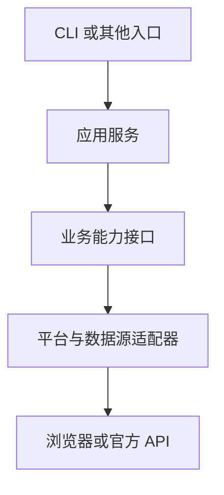

# 从应用层逐步深入 Goose 内核

## 项目目标与推进原则

本项目以真实 Agent 应用为学习载体，最终目标是理解 Goose 内核，并逐步具备修改和验证内核的能力。先从应用层的 CLI、Recipe、Skill、MCP、模型配置及工具执行入手，再沿实际调用链深入 Provider、扩展管理、权限与 Hook、Agent 状态机、上下文管理和会话持久化。

当前应用是抖音助手，后续可以接入其他平台或设备。应用需要帮助暴露和理解通用机制，业务规则应有自己的模块边界。复用 Goose 现有机制，并通过源码阅读和实验判断是否需要内核改动。学习内核本身是正式目标；有依据的、小范围通用内核实验属于后续推进方向。

每次实验围绕一个具体问题：调用怎样进入、经过哪些模块、产生什么状态或事件、失败与取消如何传播。先建立可复现案例，再修改，并记录源码位置、验证结果和适用边界。

定制仍使用 `BM_` 标识、功能分支与 PR。上游同步使用 merge；内核改动应小而独立，方便理解、审查和跟进上游。设备配置、模型凭据、账号值和真实会话记录只保存在本地私有目录。

## 当前实现的问题

当前实现已跑通受限只读应用。职责拆分改善了可维护性，但模块的输入、输出和依赖仍带有具体业务假设。

| 耦合点 | 当前表现 | 扩展影响 |
| --- | --- | --- |
| 执行器与模型 | Agent 启动代码指定 DeepSeek 配置、凭据变量与 Provider | 换模型需要修改启动代码 |
| 执行器与任务 | 提示词、工具集合和读取限制写在 Agent 脚本中 | 每个任务容易复制一套执行代码 |
| 能力声明分散 | MCP、Recipe、Hook、探测和事件处理分别认识工具名或字段 | 加工具要同步改多个位置 |
| 业务与数据源 | 账号和作品操作直接接收浏览器配置 | 切换官方 API 时容易影响上层 |
| 通用事件与业务结果 | 事件解析认识抖音摘要字段 | 新能力需要改通用解析器 |
| 存储与路径 | 最近结果依赖固定 JSON 文件名 | 多账号、历史查询和数据库迁移缺少边界 |
| 认证与执行状态 | 服务用进程内布尔值记录先前检查成功 | 不能代表账号绑定、实时授权或持久业务状态 |
| 异常与诊断 | CLI 将多种异常转为同一条提示 | 扩展后难以区分配置、权限、工具与运行失败 |

## 建议的模块边界

下表是后续设计，尚未全部实现。先定义数据与操作的边界，随后按真实需求拆模块；模块名称不等同于必须新增一个包或进程。

| 模块 | 负责什么 | 接口或依赖约束 |
| --- | --- | --- |
| `BM_entrypoints` | CLI、后续其他入口的参数与输出 | 调用应用服务，不包含 DOM、Provider 或存储实现 |
| `BM_application` | 选择任务、组装执行上下文、调用能力和保存业务结果 | 依赖能力与存储接口、Goose 运行适配器 |
| `BM_tasks` | 任务说明、工具子集、预算和输出要求 | 使用 Recipe；需要操作知识时使用 Goose Skill |
| `BM_capabilities` | 能力标识、参数结构、公开结果结构、支持范围与执行上限 | 与 CLI、Goose 事件和具体浏览器分离 |
| `BM_platforms` | 抖音等平台的业务操作与数据源实现 | 按实际支持能力选择网页或官方 API 实现 |
| `BM_mcp` | 将业务能力暴露为 MCP、协议校验和安全错误转换 | 作为业务模块的协议入口，不承担 DOM 实现 |
| `BM_policy` | 允许的能力与参数、账号绑定和数据披露限制 | Hook 检查调用，工具服务在执行点校验硬约束 |
| `BM_goose_runtime` | Goose 启动、Recipe 组装、版本兼容、事件转换和生命周期 | 复用原生 Provider；不包含平台选择器和业务摘要字段 |
| `BM_storage` | 读取快照、任务记录、业务操作回执 | JSON 或 SQLite 实现；与 Goose 会话存储分开 |
| `BM_infrastructure` | 私有配置、浏览器会话、文件权限和进程资源 | 由组装层注入实际实现 |

主要业务依赖保持单向：

Agent 路径由应用服务加载任务并启动 Goose；Goose 根据 Recipe 使用 MCP 调用同一业务能力。MCP 和 CLI 共用业务实现，数据源适配器无需认识 Goose。

### 模型与任务

应用选择 Goose 原生 Provider 和模型，凭据使用对应原生配置机制。保留运行隔离与本地模型生命周期脚本，移除业务执行器里固定的模型供应商分支。需要核查每次运行的私有 Goose 状态如何获取所需模型配置，避免破坏隔离或自动加载其他扩展。

任务通过 Recipe 声明指令、工具子集和运行预算；Skill 提供可复用操作知识。Skill 文本不能授予权限，实际工具集合和执行限制由运行配置及工具服务约束。当前只读任务明确拒绝 Skill；启用 Skill 是后续独立变更，需验证它可能使用的全部工具。

### 能力与规则

先用一个简单的 `BM_capability` 定义维护稳定标识、参数 Schema、公开返回 Schema 与硬性参数上限。MCP 描述、探测校验和结果投影尽量复用这些定义。保留现有 MCP 工具名称作为兼容入口。

任务允许的工具与参数范围只能收窄服务支持范围。Hook 负责执行前拒绝，服务负责账号上下文和执行点检查；共同复用规则定义，也分别验证各自实际输入。页面账号切换或登录失效时，先前一次检查成功不应成为永久通行条件。

通用事件解析只识别 Goose 的消息、工具请求、工具响应和终止事件；业务结果校验由具体能力处理。公开结果采用每个能力的显式字段结构，真实业务字段留在私有存储。不要将“允许返回字段的并集”当作所有工具共有的披露规则。

### 平台与数据源

优先抽象实际已有的操作，例如 `BM_check_account(BM_context)`、`BM_list_works(BM_context, BM_limit)`。上下文包含选定平台、账号引用与数据源引用；凭据和浏览器资源在本地解析，不传给模型。

网页与官方 API 通过各自实现返回明确的来源、范围、完整性及平台字段。平台声明支持哪些操作；不支持的功能返回清晰限制。不要把不同平台的字段强行统一，也不要假设网页和 API 有相同权限与数据完整性。新增第二种真实实现时再验证和完善接口。

独立浏览器 Profile 属于网页适配器的会话资源，用于隔离登录资料。将打开、复用、检查与关闭收敛到会话管理，通常由应用自动准备；业务层只调用能力。选择 API 数据源时不应需要浏览器依赖。

### 存储与错误

先定义 `BM_save_snapshot`、`BM_latest_snapshot` 和 `BM_save_run` 等少量业务操作，继续用私有 JSON 实现；有历史查询或并发需求时再增加 SQLite。读取快照、应用任务状态、写操作回执和 Goose 会话分别管理。发布等写能力将来需要业务幂等、回执与结果核对，不能依赖模型答复判定成功。

错误应保留安全的类型与错误码，例如配置无效、登录失效、能力不支持、执行失败、超时。入口根据错误码输出提示；具体页面内容、凭据、路径和原始异常留在私有诊断中。

## 哪些需求可能进入 Goose 内核

当前尚无已证实必须修改内核的需求。下面列出值得学习与验证的通用问题，先检查原生机制，只有可复现缺口才进入 Rust 实现。

| 问题或实验 | 先使用的应用层/原生机制 | 可能涉及的内核位置 | 进入内核的条件 |
| --- | --- | --- | --- |
| 更换云端或本地模型 | 原生 Provider、模型配置、声明式 Provider | Provider 接口、实现和请求/响应转换 | 所需协议或字段无法通过现有配置表达，并有兼容性案例 |
| 工具允许集合与暴露集合一致 | 显式扩展、`available_tools`、Hook、服务端约束 | 扩展管理、工具收集、Skill 相关操作 | 原生配置下仍有不应暴露或可绕过的执行路径 |
| 工具拒绝与取消生命周期一致 | PreToolUse、超时、已有取消机制 | 工具审批/执行操作、Hook、扩展客户端 | 测试证明某类执行绕过检查或取消无法传播 |
| 统一可解析的运行事件 | 原生 `stream-json` 或已公开的集成接口 | CLI 序列化、Agent 事件 | 关键结果或终止原因缺失，需要通用事件改进 |
| 推理、工具调用和重试行为 | Recipe 预算、原生限制、Mock Provider | 状态机组装、推理、重试与工具操作 | 已有配置无法满足通用运行语义，且不会破坏其他任务 |
| 长上下文与失败恢复 | 原生会话、上下文压缩；外部业务状态 | 状态机压缩操作、会话管理 | 证实属于 Agent 会话/上下文缺口，而非业务数据库职责 |
| 沙箱与资源生命周期 | 原生容器选项、外部工具服务隔离 | 容器、扩展进程、工具调用上下文 | 需要通用隔离或资源清理能力，现有接入无法实现 |

抖音 URL/DOM 选择器、平台 API 权限、个人配置、浏览器 Profile、业务数据库和设备控制规则留在应用与工具模块。它们是学习内核的入口；内核实验围绕可复用机制展开。

工具白名单、私有目录和独立浏览器 Profile 各有作用，但它们不能替代 OS 沙箱。设备控制工具的物理限位、急停和动作权限同样应由设备服务落实。

## 根据真实源码学习

源码位置按 fork 的 `948b3571f3017831b2ac0daba61ee75281d493c5` 快照核查。已安装 CLI 与源码快照可能不同，运行实验前记录版本并使用对应源码。同步上游后重新确认路径；旧说明中的 `crates/goose/src/agents/agent.rs` 在此快照已不存在。

| 学习层次 | 源码入口 | 要回答的问题 |
| --- | --- | --- |
| CLI 与 Recipe | [CLI](../../crates/goose-cli/src/cli.rs)、[Recipe](../../crates/goose/src/recipe/mod.rs) | 参数、任务和扩展配置怎样进入一次运行？ |
| 模型接入 | [Provider 接口](../../crates/goose-provider-types/src/base.rs)、[Provider 管理](../../crates/goose/src/agents/provider_manager.rs) | 配置怎样选择 Provider？流式响应怎样进入推理操作？ |
| MCP 扩展 | [扩展管理](../../crates/goose/src/agents/extension_manager/mod.rs) | 工具怎样发现、过滤、加命名空间和分配执行资源？ |
| 权限与 Hook | [工具执行操作](../../crates/goose/src/agents/state_machine/ops_toolcalling.rs)、[工具审批](../../crates/goose/src/agents/state_machine/ops_tool_approval.rs)、[Hook](../../crates/goose/src/hooks/mod.rs) | 模型发出调用后，哪些检查发生在真实执行之前？ |
| Agent 循环 | [状态机组装](../../crates/goose/src/agents/state_machine_builder.rs)、[Goose 状态机](../../crates/goose/src/agents/state_machine/mod.rs)、[通用状态机](../../crates/goose-agent/src/machine.rs) | 推理、工具、重试、结束等步骤怎样排列和重入？ |
| 上下文与会话 | [压缩操作](../../crates/goose/src/agents/state_machine/ops_compaction.rs)、[会话管理](../../crates/goose/src/session/session_manager.rs) | 什么会被持久化？压缩与恢复保留哪些状态？ |

`crates/goose/src/providers/base.rs` 在此快照重导出 Provider 接口并定义集成层的 `ProviderDef`；应继续跟到 `goose-provider-types` 中的接口。状态机同样分为 `goose` 集成层和 `goose-agent` 通用机制，不宜把循环理解为一个函数里的简单 while。

## 建议的实施与学习顺序

1. 模型配置回归 Goose：移除固定供应商启动逻辑，验证原生配置选择及运行隔离；阅读 Provider 管理和接口。
2. 任务与能力分离：保留当前工具名，将任务放到 Recipe，集中能力结构和规则定义；阅读扩展工具过滤与 Hook 执行顺序。
3. 数据源与存储接口：在真实新增数据源/平台时实现第二个适配器，用合成数据检查 CLI 和 MCP 共用业务逻辑；按需求引入 SQLite。
4. 追踪完整调用链：使用合成 MCP 工具与 Mock Provider，分别观察正常调用、拒绝、错误、超时、取消和达到运行上限；记录状态机执行路径。
5. 选择一个通用内核实验：从已复现的问题中选最小改动，增加对应 Rust 回归，按仓库规范执行格式、相关测试与静态检查，再提交独立 PR。

每阶段留下短 Markdown：实验问题、源码快照、相关模块、合成复现步骤、观察结果和下一步。无需公开真实账号内容或原始日志。学习可以先通过阅读、断点和测试完成；内核修改以具体机制和验证为单位推进。
