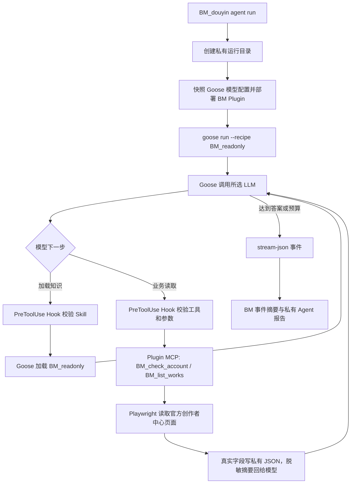
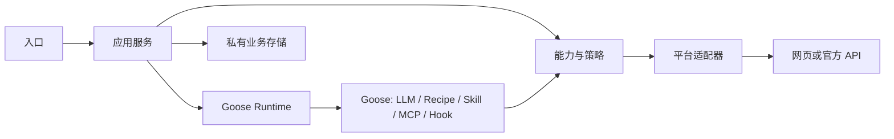

# 从应用层逐步深入 Goose 内核

## 项目目标与推进原则

本项目以真实 Agent 应用为学习载体，最终目标是理解 Goose 内核，并逐步具备修改和验证内核的能力。当前应用是抖音只读助手，后续可以接入其他平台、模型或设备；平台规则不进入通用内核，模型、任务和工具循环优先复用 Goose 原生机制。

推进顺序是：先从应用层的 CLI、Recipe、Skill、MCP、模型配置及工具执行建立可复现案例，再沿实际调用链深入 Provider、扩展管理、权限与 Hook、Agent 状态机、上下文管理和会话持久化。只有当原生机制经实验证实存在通用缺口时，才做小范围、可回归的内核实验。

每次实验围绕一个具体问题：调用怎样进入、经过哪些模块、产生什么状态或事件、失败与取消如何传播。记录源码版本、相关模块、复现步骤、观察结果和适用边界。定制仍使用 `BM_` 标识、功能分支与 PR；上游同步使用 merge。设备配置、模型凭据、账号值和真实会话记录只保存在仓库外的私有目录。

## 当前已经实现的形态

当前没有修改 Goose 的 Rust 内核，也没有在业务代码中实现另一套 Agent 循环。应用通过 Goose 原生 Open Plugin、Recipe、Skill、MCP、Hook 和 Provider 配置完成接入：

| 层 | 当前实现 | Goose 承担的职责 | BM_ 应用承担的职责 |
| --- | --- | --- | --- |
| 入口 | `BM_douyin` 薄 CLI 与 Justfile | 提供 `goose` 命令、Recipe 校验和运行能力 | 参数解析、无模型工具命令、私有目录和运行编排 |
| 任务 | `BM_recipes/BM_readonly.json` | Recipe 参数、指令、预算和运行入口 | 声明抖音只读任务、默认任务和 5 轮上限 |
| 操作知识 | Plugin 内的 `BM_readonly` Skill | 原生 Skill 加载与内容注入 | 只读流程、结果解释、隐私和停止条件 |
| 工具 | Plugin 声明一个 stdio MCP Server | 工具发现、命名空间、调用和结果回传 | 实现账号检查与作品读取两个业务工具 |
| 权限 | `BM_policy.json` 与 PreToolUse Hook | 在真实工具调用前执行 Hook，失败即阻止 | 精确允许 Skill、工具和参数；服务端再做硬约束 |
| 模型 | Goose 原生 `GOOSE_PROVIDER` / `GOOSE_MODEL` | Provider 选择、请求模型、流式响应和工具循环 | 生成私有配置快照、环境隔离和日志脱敏 |
| 数据源 | 独立 Playwright Chrome Profile 与创作者中心页面 | 不直接理解浏览器或抖音 DOM | 复用用户登录态，只读取页面已展示的信息 |
| 存储 | 仓库外私有 JSON | Goose 运行使用独立私有状态根 | 保存账号/作品快照、Agent 事件摘要、日志和报告 |

当前 Agent 路径的调用关系如下：

这个形态下，模型只能看到登录状态、字段存在性、读取范围和数量等摘要；真实昵称、抖音号和作品文字保存在本地。Agent 模式要求先成功检查账号，再读取最多 3 条当前已加载作品卡片。直接 CLI 的无模型读取最多 10 条，不经过模型。

## 当前边界

已验证的是 Goose 1.57.0 与当前 Plugin/Recipe 的装载和执行链：合成回归、真实 Goose 加回环模拟 LLM、合成 MCP、Recipe 校验均通过；真实网页的无模型账号和作品读取此前已跑通。重构后的真实 LLM 工具调用质量仍需在用户选择模型后单独验证。

当前能力仅限普通创作者在官方创作者中心网页上已经可见的只读信息：

- 检查账号首页登录状态和字段存在性；
- 读取内容管理页当前已渲染的少量作品卡片；
- 标记数据来源、范围、不完整状态和截断情况；
- 不翻页、不发布、不评论、不修改、不删除、不导出互动指标；
- 不实现 OpenAPI OAuth，不抽取 Cookie，也不调用未获授权的私有接口。

Hook、allowlist、私有状态根和独立浏览器 Profile 共同缩小暴露面，但它们不是操作系统级沙箱，也不能防御拥有本机配置修改权限的操作者。网页路线还受 DOM、登录状态和页面风控影响，不能把页面能力等同于开放平台 API。

## 仍然存在的扩展问题

下表只列出当前实现之后仍然有意义的工程问题；原先“执行器绑定 DeepSeek”“任务写死在 Agent 脚本”等问题已经通过原生 Provider 和 Recipe 解决。

| 扩展点 | 当前表现 | 后续影响 |
| --- | --- | --- |
| 能力定义 | 工具名、MCP 描述、Hook 策略和 Skill 文本仍分散维护 | 新增工具时需要同步多处，容易出现声明和允许集合不一致 |
| 平台抽象 | 业务代码仍围绕抖音网页账号和作品操作组织 | 接入小红书或官方 API 时，需要第二个适配器验证接口，不宜提前过度泛化 |
| 数据源元数据 | 网页结果能标记来源、范围和完整性，但平台/账号/数据源上下文仍较轻 | 多账号、多平台或 API/网页混用时，需要显式上下文和授权状态 |
| 业务存储 | 最近结果使用固定私有 JSON 文件名 | 多账号、历史查询、并发运行、幂等回执和数据库迁移需要独立存储边界 |
| 事件模型 | 解析器目前提取本次两个只读工具的安全摘要 | 新能力应有自己的结果投影，通用事件层不应认识越来越多业务字段 |
| 错误类型 | CLI 对若干本地异常仍输出统一安全提示 | 扩展后需要区分配置无效、登录失效、能力不支持、页面变化、超时和权限拒绝 |
| 浏览器生命周期 | 独立 Profile 是当前网页适配器的必要资源，但仍由单独命令准备和复用 | API 数据源不应依赖浏览器；后续可把会话资源进一步收敛到平台适配器内 |
| Provider 兼容 | 已把模型选择交回 Goose，但真实本地/托管 Provider 尚未逐一验证 | 自管工具循环的 hosted agents 或特殊兼容协议可能需要单独验证 |
| Goose 版本兼容 | 回环测试固定当前实际安装版本，升级后默认扩展集合可能变化 | 每次升级需复测模型实际可见工具、Hook 顺序和 Recipe 装载 |

## 建议的模块边界

下表是持续重构的目标边界，不要求每个模块对应一个新包或进程。短期优先保持文件小、接口清楚，并在新增第二种真实平台或数据源时验证抽象。

| 模块 | 负责什么 | 接口或依赖约束 |
| --- | --- | --- |
| `BM_entrypoints` | CLI、Just、后续设备或 Bot 入口的参数与输出 | 只调用应用服务，不包含 DOM、Provider 或存储实现 |
| `BM_application` | 选择任务、组装运行上下文、调用能力和保存业务结果 | 依赖能力、存储和 Goose Runtime 接口 |
| `BM_tasks` | Recipe、Skill 操作知识、任务预算和输出要求 | 只声明任务需要的能力；Skill 文本不能授予权限 |
| `BM_capabilities` | 稳定能力 ID、参数 Schema、公开返回 Schema、支持范围与硬上限 | 同时供 MCP 描述、探测、Hook 策略和结果投影复用 |
| `BM_platforms` | 抖音等平台的业务操作与数据源实现 | 网页、开放平台 API 等分别实现，不强行统一字段 |
| `BM_mcp` | 把业务能力暴露为 MCP、做协议校验和安全错误转换 | 是协议入口，不承担 DOM 或平台授权实现 |
| `BM_policy` | 允许的能力、参数范围、账号上下文和披露限制 | Hook 与工具服务各自检查实际输入，不能只依赖提示词 |
| `BM_goose_runtime` | Goose 启动、Recipe 绑定、版本兼容、事件转换和生命周期 | 复用原生 Provider；不包含抖音选择器或业务摘要字段 |
| `BM_storage` | 快照、任务记录、运行报告和未来写操作回执 | JSON 或 SQLite 实现；与 Goose 会话存储分开 |
| `BM_infrastructure` | 私有配置、浏览器会话、文件权限和进程资源 | 由组装层注入；平台业务代码只接收必要资源 |

主要业务依赖保持单向：

CLI 和 MCP 应共用同一套业务能力实现。Agent 路径只是让 Goose 根据 Recipe 和模型决策来调用这些能力；切换数据源时不应重写 Agent 循环，新增任务时也不应复制一份执行器。

### 模型与任务

模型选择继续使用 Goose 原生 Provider、模型和密钥配置。`BM_` 脚本只负责准备私有状态根、过滤外部环境、固定隔离选项和保存日志，不在业务代码里建立供应商分支。本地 Ollama 生命周期由独立脚本管理，不把模型开关写进 Goose 内核。

任务通过 Recipe 声明指令、预算和输出要求；操作知识放在 Skill。权限由配置、Hook 和工具服务共同决定，Skill 只能告诉模型如何安全完成任务，不能扩大工具集合。用户任务以私有 Recipe 文件绑定，并通过 JSON 转义避免被 Goose 模板语法解释。

### 能力、平台与数据源

优先从已经存在的操作抽象稳定接口，例如 `BM_check_account(BM_context)`、`BM_list_works(BM_context, BM_limit)`，不要为尚未实现的发布、评论或多平台能力提前设计庞大层级。上下文至少应能表达平台、账号引用、数据源和授权范围；凭据、浏览器 Profile 与绝对路径在本地解析，不传给模型。

网页与官方 API 是不同数据源：字段完整性、权限、分页、错误码和风控语义都不同。平台适配器应返回明确的来源、范围、完整性及平台原始字段；不支持的能力返回清晰限制。等第二个真实平台或第二种数据源出现时，再据此收敛接口。

独立浏览器 Profile 是网页适配器的会话资源，用于隔离登录资料，而不是平台能力本身。选择官方 API 数据源时不应要求启动浏览器。未来设备端 Bot 只运行入口或远程调用工具时，也应把浏览器和模型服务保留在外部受控机器上。

### 存储、状态与错误

先定义少量业务存储操作，例如 `BM_save_snapshot`、`BM_latest_snapshot`、`BM_save_run` 和未来写操作的 `BM_save_receipt`。当前继续使用私有 JSON；出现历史查询、多账号、并发或幂等需求时再引入 SQLite。业务快照、应用运行状态、写操作回执与 Goose 会话分别管理。

错误应保留安全的类型与错误码，例如配置无效、登录失效、能力不支持、数据源不支持、页面结构变化、执行失败、超时或取消。入口只向终端展示可操作提示，具体页面内容、凭据、路径和原始异常留在私有诊断中。模型答复不能作为发布、修改等写操作成功的依据。

## 哪些需求可能进入 Goose 内核

当前尚无已证实必须修改内核的需求。下面的问题先使用原生机制和合成实验验证；只有能在当前源码上稳定复现、且属于通用 Agent 机制而非抖音业务规则时，才进入 Rust 实现。

| 问题或实验 | 先使用的应用层/原生机制 | 可能涉及的内核位置 | 进入内核的条件 |
| --- | --- | --- | --- |
| 更换云端或本地模型 | 原生 Provider、模型配置、声明式 Provider、本地 OpenAI 兼容服务 | Provider 接口、Provider 管理、请求/响应格式转换 | 所需协议或字段无法通过现有配置表达，并有兼容性回归 |
| 工具允许集合与暴露集合一致 | 显式 Plugin、`available_tools`、PreToolUse Hook、服务端限制 | 扩展管理、工具收集、Skill 工具操作 | 原生配置下仍有不应暴露或可绕过的执行路径 |
| 工具拒绝与取消生命周期 | Hook、超时、进程取消、MCP 错误返回 | 工具审批/执行操作、Hook、扩展客户端 | 测试证明拒绝或取消不能可靠传播，且影响通用任务 |
| 统一可解析的运行事件 | 原生 `stream-json` 与现有事件字段 | CLI 序列化、Agent 事件、会话输出 | 关键工具结果或终止原因缺失，无法由外部可靠判断 |
| 推理、工具调用和重试预算 | Recipe `max_turns`、max tokens、重复工具限制、Mock Provider | 状态机组装、推理、重试和工具操作 | 现有预算无法表达通用运行语义，且改动不会破坏其他任务 |
| 长上下文与失败恢复 | 原生会话、压缩、外部业务状态 | 状态机压缩操作、会话存储与恢复 | 缺口属于 Agent 会话/上下文，而非业务数据库或工具幂等 |
| 沙箱与资源生命周期 | 独立进程、私有状态根、外部工具服务、Goose 现有容器选项 | 容器、扩展进程、工具调用上下文 | 需要跨应用复用的隔离或资源清理能力，现有接入无法实现 |
| 远端或设备端执行 | Streamable HTTP MCP、外部受控机器、独立工具服务 | MCP 传输、扩展租约、超时与取消 | 本地 stdio 无法满足部署形态，且需要框架级连接生命周期管理 |

抖音 URL/DOM 选择器、平台 API 权限、个人配置、浏览器 Profile、业务数据库和设备控制规则留在应用与工具模块。设备控制工具的物理限位、急停和动作权限必须由设备服务落实，不能把 Goose Hook 当物理安全边界。

## 根据真实源码学习

当前文档的路径按 fork 当前 `main`（HEAD `26d9b0aa1`）的 Git 树核对。由于本地使用 sparse checkout，部分路径可能不在工作区，但可用 `git show <rev>:<path>` 或 `git ls-tree` 阅读。以后升级 Goose、运行真实模型实验或修改内核前，先记录精确版本并重新核对路径。

| 学习层次 | 当前源码入口 | 要回答的问题 |
| --- | --- | --- |
| CLI 与 Recipe | `crates/goose-cli/src/cli.rs`、`crates/goose-cli/src/commands/recipe.rs`、`crates/goose/src/recipe/mod.rs` | 参数、子命令、Recipe 文件和参数怎样进入一次运行？ |
| 模型接入 | `crates/goose-provider-types/src/base.rs`、`crates/goose/src/agents/provider_manager.rs`、`crates/goose/src/providers/base.rs` | 配置怎样选择 Provider？流式响应怎样进入推理操作？ |
| MCP 扩展 | `crates/goose/src/agents/extension_manager/mod.rs`、`crates/goose/src/agents/mcp_client.rs` | 工具怎样发现、过滤、加命名空间、启动子进程和分配执行资源？ |
| Skill 与 Plugin | `crates/goose/src/skills/client.rs`、Plugin/Recipe 相关加载代码 | Plugin 清单、Skill 路径、exclusive 配置和默认扩展迁移怎样相互作用？ |
| 权限与 Hook | `crates/goose/src/agents/state_machine/ops_toolcalling.rs`、`crates/goose/src/agents/state_machine/ops_tool_approval.rs`、`crates/goose/src/hooks/mod.rs` | 模型发出调用后，哪些检查发生在真实执行之前？Hook 失败怎样传播？ |
| Agent 循环 | `crates/goose/src/agents/state_machine_builder.rs`、`crates/goose/src/agents/state_machine/mod.rs`、`crates/goose-agent/src/machine.rs` | 推理、工具、重试、结束等步骤怎样排列和重入？ |
| Recipe 状态操作 | `crates/goose/src/agents/state_machine/ops_recipe.rs` | Recipe 任务、参数和调度状态怎样进入状态机？ |
| 上下文与会话 | `crates/goose/src/agents/state_machine/ops_compaction.rs`、`crates/goose/src/session/session_manager.rs` | 什么会被持久化？`--no-session`、压缩与恢复分别保留哪些状态？ |

不要把 Agent 循环理解成一个简单 `while`。当前代码分为 Goose 集成层和 `goose-agent` 通用状态机机制；阅读时应从一次真实 CLI 调用跟踪到状态机操作，再回到应用层事件验证。

## 建议的实施与学习顺序

1. **真实模型验证**：使用 Goose 原生配置接入所选云端或本地模型，跑通当前只读 Recipe；记录实际工具集合、工具调用顺序、拒绝、超时、Token 和最终答复。
2. **能力定义收敛**：在不改变工具协议的前提下，集中两个现有能力的名称、参数、公开返回和硬上限，让 MCP 描述、Hook 策略和探测校验复用同一定义。
3. **业务存储接口收口**：为账号/作品快照和 Agent 运行报告定义少量内部接口，先保持私有 JSON 实现；有多账号或历史需求时再增加 SQLite。
4. **第二个数据源或平台**：优先用真实需求驱动第二个适配器，例如抖音官方 API（取得资质和 Scope 后）或小红书网页/API；用合成数据验证 CLI、MCP 和 Agent 共用业务逻辑。
5. **追踪完整调用链**：用合成 MCP 与 Mock Provider 分别观察正常调用、Hook 拒绝、工具错误、超时、取消、达到预算和压缩；再用真实模型对照差异。
6. **选择一个通用内核实验**：从已复现的问题中选择最小改动，增加 Rust 回归，按仓库规范执行格式、相关测试和静态检查，再提交独立 PR。

每阶段留下短 Markdown：实验问题、Goose 版本或源码快照、相关模块、合成复现步骤、真实结果（不含个人数据）、观察结论和下一步。内核学习可以先通过阅读、断点、Mock Provider 和测试完成；真正修改内核时，以一个可复用机制和可验证问题为单位推进。
