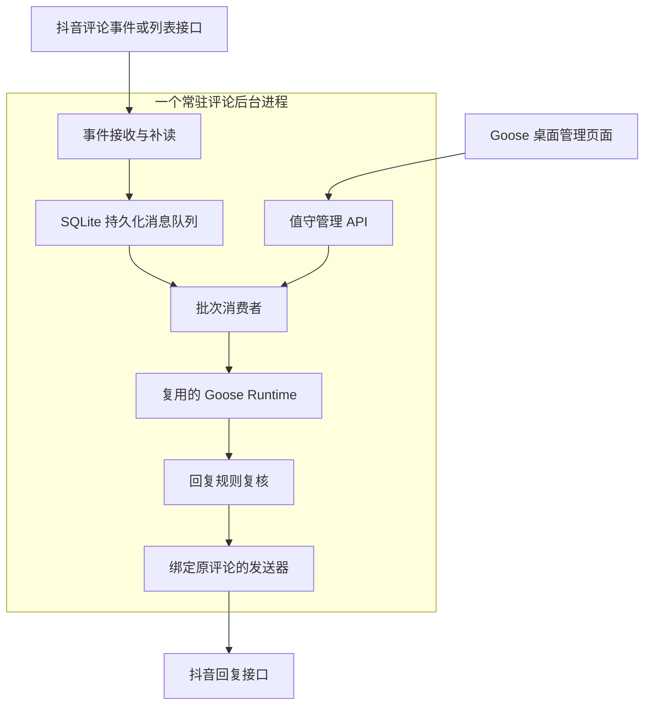

# 评论区值守：单进程消息处理与 Goose 集成设计

状态：已实现 Rust API library、常驻队列服务、进程内 Goose 适配、桌面管理、Electron IPC 与扫码创建私有配置；真实平台评论读写尚未完成。源码核查日期：2026-11-06。

桌面扫码配置由 `BM_login` 管理官方网页窗口，`BM_privateConfig` 管理仓库外持久化，独立于 Rust 评论 API。新建账号使用独立浏览器目录，保存可见昵称与抖音号及值守规则；默认目录、取消清理和切换流程见 [桌面创建与账号切换](../BM_watch/BM_README.md#桌面创建与账号切换)。网页抖音号不等于 OpenAPI 身份，保存浏览器状态并未接通评论读取或发送。

最新决定是使用 Rust 小型 API 封装，保持单个评论后台进程。当前入口与命令见 [BM_watch 使用说明](../BM_watch/BM_README.md)，API 状态见 [Rust API 分层](BM_douyin_api_design.md)。

原生模拟测试证实 Goose 的 SkillOperation 自动注入 load_skill，不受空扩展列表控制。本实现增加 `StateMachineServicesConfig.BM_disable_skills`，默认 false；专用评论 Runtime 设置 true，关闭发现、加载和 Skill 快捷命令。该开关是最小通用内核改动，不是完整多角色权限系统。

## 1. 确定的需求与执行形态

管理员在 Goose 桌面端注册值守任务，选择自己的一条或多条作品，配置拒绝词与 AI 回复标记，手动启动、暂停或停止。自己的人工评论也可触发；自己的 AI 回复通过来源标志、标记前缀与已提交记录防循环，命中拒绝词则跳过，不调用模型。关闭界面后继续运行；符合规则自动回复，其余跳过或待处理。外部评论使用 external 上下文，不能调用管理员工具。

采用一个常驻评论后台，包含事件接收、持久化队列、消费者、Goose Runtime 和回复发送器。不为每条评论、每批评论或每个任务启动 Goose 进程。Runtime 在服务启动时创建并持续复用；评论处理创建的是逻辑会话或上下文，不是操作系统进程。

用户提出的批处理方案成立：默认每 30 秒领取一批待处理评论，批大小与并发可配置。30 秒是消费队列的业务设置，不是抖音官方限流参数，也不要求每 30 秒无条件发送 API 请求。无消息时不调用模型。

## 2. 官方评论消息能力：已确认与待验证

### 2.1 评论事件推送确实存在

官方文档 [接收评论回复事件](https://developer.open-douyin.com/docs/resource/zh-CN/dop/develop/openapi/interaction-management/comment-management-user/accept-comment-reply-event/) 的搜索索引显示：

- 事件名 `item_comment_reply`，基于 Webhooks 推送。
- 要求用户授权 `item.comment`，文档写明授权成功后 1 小时生效。
- 消息外层包含 event、from_user_id、to_user_id、client_key 和 content。
- content 的索引片段描述 parent_id：二级/三级评论指向所属一级评论，一级评论指向视频 ID。

这证明存在评论推送能力，并有不同评论层级的说明；尚不能据此承诺覆盖所有作品的新评论、删除/审核变更或完整历史。具体触发范围、事件订阅可用性和字段必须结合实际应用权限与真实事件验证。

本轮直接访问该评论事件页仅得到页面外壳，上述事件详情来自官方搜索索引；不能将其作为已经完整读取最新接口正文的证据。

### 2.2 Webhook 接收规范已读到正文

[移动/网站应用 Webhooks 概述](https://developer.open-douyin.com/docs/resource/zh-CN/dop/develop/webhooks/summarize) 本轮直接读取到正文：

- 用户须授权事件对应 Scope，应用在控制台订阅事件。
- 配置回调地址时发送 `verify_webhook`，回传 content.challenge。
- 以请求头 `X-Douyin-Signature` 验证来源；文档算法为 SHA-1(client secret + 原始请求体)。不能先重新序列化 JSON 再验签。
- 通过 `Msg-Id` 去重。
- 文档写明连接超过 5 秒断开、共重试 3 次；长时间不响应可能取消订阅。

接收路径只做请求大小限制、验签、应用/账号与事件校验、持久化入队和快速响应，不在 HTTP 回调中等待模型生成。队列落盘失败不返回处理成功。重试消息幂等入队。

本地回环端口不能直接接收平台推送。Webhook 路径需要平台注册且可达的回调地址；公网入口必须与本地管理接口隔离。架构不依赖当前机器已经具备公网入口。

### 2.3 列表补读与回复

官方 [移动/网站应用 SDK 总览](https://developer.open-douyin.com/m/docs/resource/zh-CN/dop/develop/openapi/sdk-overview) 搜索索引列出 `GET https://open.douyin.com/item/comment/list/`，Scope 为 `item.comment`。

官方 [回复视频评论](https://developer.open-douyin.com/docs/resource/zh-CN/dop/develop/openapi/interaction-management/comment-management-user/video-comment-reply/?is_new_connect=0&is_new_user=0) 索引说明需要申请并授权 `item.comment`，只能回复授权用户自己的视频，并写明图集暂不支持评论。官方 [回复不展示说明](https://developer.open-douyin.com/helpCenter/home/detail/34/103) 涉及 `/item/comment/reply/`，说明回复可能需要审核，接口接受不代表平台已展示。

这些是公开文档依据，未验证当前应用可调用。评论列表的最新参数、分页排序、游标语义、配额与回复回执完整结构未读到可核对正文，实施前核验。不把企业号接口、小程序接口、直播弹幕或生活服务消息接口套用到普通作品评论。

优先接入已获批的评论 Webhook，列表接口补读启动基线、丢失消息和覆盖缺口；仅列表能力可用时，定时分页拉取同样进入队列。网页路线需在官方产品实际页面另行验证，不能用浏览器伪造未授权的 OpenAPI 调用。

已有抖音账号不等于具备应用、Scope 和回调订阅资格。公开仓库不记录个人准入状态或真实事件内容。

## 3. 单进程组件关系

Webhook 与补读是同一队列的两种输入；消费、生成和发送在同一后台进程内组织成异步任务。SQLite 存队列与业务状态，不增加 Redis 或独立消息中间件。桌面端及其原有聊天进程不属于新增的评论 Worker；不为评论额外创建进程。

后台由系统服务管理器托管。macOS 用用户级 launchd，关闭窗口或退出桌面端不结束后台。后台启动仅恢复已经启用的任务，暂停/停止任务不自动启用。没有有效任务就不接入账号或调用模型。

## 4. 怎样在同一进程复用 Goose

现有 Python `BM_run_agent` 调用 `goose run` 子进程是一次性 CLI 入口，不适合作为评论长期处理路径。保留这个人工命令，值守路径不调用它。

推荐新增 Rust 应用 crate，在同一进程依赖当前 fork 的 `goose` crate，初始化 `Arc<StateMachineServices>` 并复用其 Provider、会话管理、Agent 状态机与运行事件。业务模块放在 `BM_custom`；不重写模型协议或 Agent 循环。

源码依据：

- `crates/goose/src/agents/services.rs`：`with_config` 返回共享服务；`reply` 接收 Message、SessionConfig 和取消 Token，返回 AgentEvent 流。
- `crates/goose/src/agents/types.rs`：SessionConfig 表示逻辑会话，不是进程。
- `crates/goose/src/acp/server_factory.rs`：已有 OnceCell 初始化并共享 StateMachineServices 的长期服务模式，可参考其生命周期。
- `crates/goose/src/model_config.rs`：复用原生 Provider/Model 配置解析。
- `crates/goose/src/agents/final_output_tool.rs` 与 `state_machine/ops_recipe.rs`：复用 Recipe 的结构化最终输出和校验。

不能只调用一次 `reply` 就宣称继承 CLI 的全部行为：执行适配必须显式准备会话、绑定 Recipe、选择 Provider、设置模式/预算、开启允许扩展、收集事件并释放结束会话；按现有 CLI session builder 和 Scheduler execute_job 路径核对。

当前 `goose-sdk` 的 UniFFI 主要提供 Provider 构建与流式 completion，不是可以直接在 Python 内调用完整 Goose Agent 的现成 API。故不以 Python GDK 作为未经验证的完整 Agent 嵌入方案。

`goose` crate 的公开 Rust 接口属于内部实现，不承诺稳定。适配集中在一个 BM 模块，固定 fork 版本并在上游 merge 后回归；避免业务模块到处依赖 Goose 内部类型。

不需要修改 Rust Agent 循环才能使用这些能力。新增 crate 的 Cargo 配置和源码集成属于项目改动；是否要向已有 goose serve 注入值守模块是另一个明确的部署选择，不能靠改名字声称零改动。

## 5. 队列与批次消费

队列中的事件归一化为平台、账号引用、作品标识、评论标识、父评论标识、事件标识、事件时间、正文和接收来源。敏感字段只保存在私有目录，不把原始推送整体交给模型。

接收先验证来源与目标，再入队。事件 Msg-Id 用于推送去重，稳定评论标识用于 Webhook 和列表结果交叉去重。只处理已启用任务选定且确认属于账号自己的作品，过滤自己发送的回复，防止自动回复反馈循环。

默认消费者每 30 秒领取最多 N 条到期记录。使用数据库租约和有界并发，批次未完成时不启动重叠的同账号发送；积压留队而不是无限并发调用模型。达到批量阈值可提前消费，此参数是可选调优，不影响正确性。

批量领取不等于把所有用户评论拼成同一个长期对话。默认每条评论有独立逻辑上下文，复用同一 Runtime；同一线程后续评论可在受控长度内复用 thread 对应会话。多个用户的历史不能进入管理员对话。

如配置一次模型请求处理多条评论，只合并相同任务/规则版本的评论，输出逐条绑定输入引用并校验数量、引用和决策。批次请求失败可回到逐条处理；此处逐条仍在同一进程里执行。默认优先批量取队列、逐条会话处理，减少不同用户内容之间的影响。

30 秒消费间隔与平台请求频率独立：Webhook 到达即可落盘，列表补读按能力配额与错误退避设置频率。无消息时不调用 LLM。暂停/停止同时控制新消息领取与发送提交。

## 6. admin/external 的单进程落实

persona 是受信任入口赋予的不可变处理上下文：管理操作为 admin，评论执行为 external。用户文本和模型输出不能修改身份。

一个进程同时处理不同请求时，不能修改 `os.environ` 或全局环境变量来切换 persona。`BM_DOUYIN_PERSONA` 可以保留为人工 CLI 的启动设置；值守后台用 `BM_run_context.BM_persona` 和 session_id 关联表达 external。

在推荐的专用评论后台中，所有模型执行均为 external；admin 只访问管理 API，不在该 Runtime 内开管理员工具会话。桌面原有管理员聊天不迁移到评论 Runtime。无需设计多级角色系统，也无需按评论复制配置目录。

external 会话显式启用自己的扩展集合，不继承默认 enabled plugins，不启用账号/作品读取、浏览器、developer、skills 发现或 extensionmanager。回复知识从管理员允许的文件选取后绑定到 Recipe。允许原生 `recipe__final_output` 接收候选回复，其他扩展仅在实际需要时加入。

CLI 的 `--no-profile` 是入口行为，直接嵌入时必须落实等价的显式扩展设置，不能仅在 Recipe 里写一个字段就推断所有路径都自动受限。实际 advertised tools 和 Hook 生命周期需要验收。

候选回复不携带可任意修改的目标；账号/作品/评论由队列项与后台绑定。发送由后台策略与适配器执行，不向 external 提供凭据或管理员发送入口。语义规则无法可靠判定时进入待处理，不把模型自报置信度当确定性授权。

若以后在同一 Goose Runtime 内运行 admin 和 external 两种工具会话，需要进一步传递 session-scoped persona 到工具发现、Hook 和 MCP 配置。当前 env-only Hook 不够，此时可能涉及小范围通用内核改动；不能为了少写几行而用共享环境变量冒充会话隔离。

## 7. 存储、发送和恢复

业务数据使用独立私有 SQLite，存储接口不依赖 Goose 内部会话表：

| 数据 | 内容 |
| --- | --- |
| BM_watch_tasks / BM_watch_targets | 状态、选定作品、规则版本、generation、游标与数据覆盖情况 |
| BM_comment_inbox | 去重标识、归一化事件、处理状态、租约与重试时间 |
| BM_reply_attempts | 候选回复、发送关联、平台接受/审核/展示或未知状态、回查结果 |
| BM_watch_events | 阶段、错误码、耗时、队列积压、Goose session/run 关联 |

同一平台/账号/作品只由一个自动回复任务拥有目标；发送去重不局限于 task_id，防止重建任务后重发。规则版本变更后，排队候选回复发送前重新检查。

成功回复必须以平台回执为依据；API 接受与平台展示分别记录。发送期间崩溃或响应丢失进入结果未知，先回查，无法核实时待人工处理；不盲目重试，平台无幂等保证时不承诺 exactly-once。

暂停/停止与发送提交共享串行化边界，递增 generation，取消旧排队项。停止回执说明是否仍有在途请求，不声称可以撤销已经提交的回复。服务重启收回过期处理租约；已发送记录不重发。

默认只监督启用后发现的新评论，建立基线；历史评论处理须管理员明确选择。关机/休眠后补读受平台分页和留存能力限制，无法确认完整时显示缺口。

## 8. 前后端与代码边界

新增后台 crate 建议位于 `BM_custom/BM_watch/`，包含 BM_service、BM_ingress、BM_consumer、BM_store、BM_platform、BM_goose_runtime 和 BM_reply_policy 模块。这是模块职责，不要求额外进程。

前端复用 Goose 桌面布局，在 `ui/desktop/src/BM_watch/` 增加任务列表、作品选择、规则配置、处理记录和待处理页面。上游文件只增加导航/路由和受限桥接：App.tsx、NavigationPanel.tsx、preload.ts、main.ts。

调用路径为 React → 受限 IPC → Electron 主进程 → 本地管理 API。管理 Token 留在主进程，校验 IPC 来源，只允许固定操作与地址。管理 API 仅本地授权访问；Webhook 对外接收入口仅接受平台事件与验证请求，不暴露任务管理能力。

平台接入使用独立 Rust API library，与值守分层。依赖方向是值守消费者 → 通用评论接口，由抖音适配器实现该接口并调用独立 API library。SDK 不依赖 Goose、persona、任务、队列或数据库；语言与部署边界见 [Rust API 与分层](BM_douyin_api_design.md)。官方 API 为优先数据源；凭据、接口版本、配额和账号映射从私有配置解析。现有作品卡片标题不能充当稳定发送目标。

模型继续由 Goose 原生配置解析；不维护另一份 Provider 协议。避免配置快照随评论创建，Runtime 只在配置版本更新或服务启动时重新配置。已有 BM CLI/Skill/MCP 保留人工调用入口；可复用确定的业务协议，但不得宣称 Python 模块能直接在 Rust 进程内调用，旧网页实现的复用方式须单独验证。

## 9. 原生 Scheduler 的位置与学习目标

原生 Scheduler 是周期执行模型驱动 Recipe 的机制，当前评论 Worker 使用队列消费者，不需要用它为每次评论或每次拉取启动一轮 Agent。保留原生功能供其他任务使用，不引入另一套通用调度平台。

桌面默认本地后台与窗口租约关联，不能直接承诺关闭窗口继续监督。常驻后台由系统托管，避免借用桌面聊天的临时后台生命周期。

项目最终目标仍是学习 Goose 内核。本功能直接复用并跟踪 StateMachineServices → Provider → 状态机 → Hook/工具操作 → final_output → AgentEvent；这是进入内核的实际调用链。后续可研究会话级 persona 和权限传播，不把抖音事件格式、账号准入或发送规则写入通用内核。

## 10. 验证条件与当前边界

必要验收包括：

- 多批评论、空队列、重试和规则变更期间后台 PID 不变，不为消息启动 goose run。
- 无新评论不调用模型，30 秒消费不产生无限重叠；拥塞与失败有退避和队列指标。
- Webhook 原始体验签、challenge、Msg-Id 去重、落盘后快速响应；接收重复事件不重复回复。
- 真实验证事件触发范围与字段、作品归属、分页补读、回复接口权限和回执。
- external 会话工具集合符合配置，评论不能改变身份、目标或进入管理员历史。
- Goose 结构化结果已被原生 final_output 接受；非法输出不发送。
- 关闭桌面与重启后台后持久化任务正确恢复，暂停/停止与在途请求状态明确。
- 发送前后崩溃、平台审核、回执丢失和自身回复推送不会产生盲目重发或循环。
- 管理 API 与平台 Webhook 权限分离；日志、队列、凭据与会话仅留在本地私有目录。

桌面端已接入受限 IPC 与认证管理 API，新增记录、任务信息和关闭接口；合成 HTTP、消息与模拟模型验证核心链路，桌面模拟测试验证进程复用、私有数据投影及 frame 权限；未创建应用、配置公网回调、读取真实评论或发送回复。上述完整产品验收仍待实际接入与桌面阶段完成。事件文档详情来自官方索引，Webhook 总则已读到正文；评论列表最新分页参数与频率限制仍待核验。
