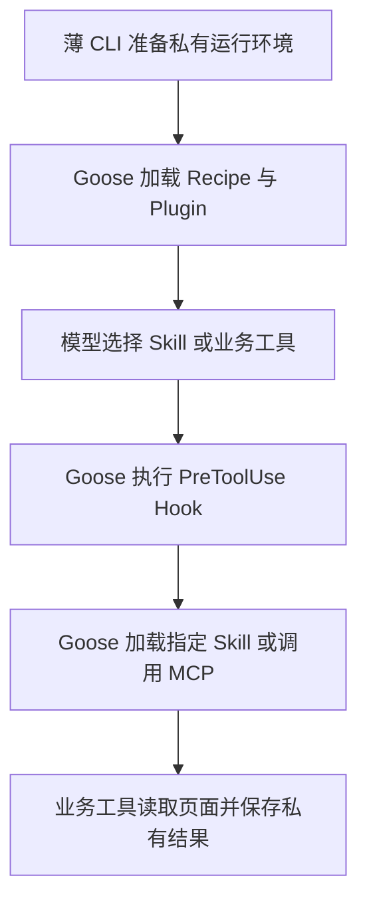

# 原生 Plugin、Recipe 与私有配置

## 职责与目录

| 公开资源 | 职责 |
| --- | --- |
| `BM_plugin/plugin.json` | 原生 Open Plugins 清单，引用自定义 Skill 与 MCP 配置路径 |
| `BM_plugin/BM_skills/BM_readonly/SKILL.md` | 只读操作知识与结果解释 |
| `BM_plugin/BM_config/BM_mcp.json` | 声明业务 MCP 启动器 |
| `BM_plugin/hooks/hooks.json` | 原生 PreToolUse Hook，执行失败阻止调用 |
| `BM_plugin/BM_policy.json` | 确切 Skill 名、工具名和参数上限 |
| `BM_recipes/BM_readonly.json` | 独立任务指令、默认任务参数和运行上限 |
| `BM_scripts/BM_goose_setup.py` | 私有部署、原生配置快照和环境隔离 |
| `BM_scripts/BM_goose_migration.py` | 旧模型文件的一次性迁移兼容 |
| `BM_scripts/BM_agent.py` | 将任务绑定到 Recipe 并执行 Goose，处理退出、日志和结果 |

`SKILL.md`、`plugin.json`、`hooks/hooks.json` 和 `.agents/plugins` 使用原生发现机制要求的名称，其余自定义资源使用 `BM_`。Skill 名采用用户约定的 `BM_` 前缀，已经通过 Goose 真实加载验证。

## 准备与运行

`prepare` 将公开 Plugin 复制到本地私有 `BM_data_dir/.agents/plugins/BM_douyin`，生成仅含本地 Python、业务脚本路径和业务环境的 `BM_runtime.local.json`。公开 Plugin 不保存设备路径、登录资料或凭据。该步骤是本地部署，不通过 `goose plugin install` 安装整个 Goose fork；后续单独发布 Plugin 仓库时再使用原生 Git 安装流程。

每次 Agent 执行再部署一份 Plugin 到私有运行目录的 `.agents/plugins`，Goose 从当前工作目录发现它。原生模型配置快照位于该运行目录的 `BM_goose_state/config`。稳定配置用于模型选择，每次运行的状态和日志分别隔离。

Recipe 指令和运行设置由公开文件维护。CLI 用 JSON 字符串转义隔离模板标记，将用户任务绑定到私有 Recipe 的 `prompt`，不在命令参数中传任务，也不拼接 Hook 或工具列表。独立 Recipe 同时保留 Goose 原生参数供直接使用；CLI 不将任意任务字符串作为 Recipe 模板执行。

Plugin 清单的组件路径必须以 `./` 开头。配置使用 `exclusive` 避免默认目录重复收集。Recipe 不设置 `extensions`，让 Goose 自动加载 Plugin MCP；显式列表或 `--no-profile` 会改变加载行为。不要在 Recipe 和 Plugin 中重复声明同一个 MCP。空扩展配置可能触发 Goose 默认扩展迁移；运行快照通过原生 disabled 条目禁用已核查的平台扩展，并由回环测试检查模型实际可见工具集合。

## 调用链

Skill 加载走 Goose 原生 Skill 操作，MCP 调用走扩展管理与工具执行。Goose 的状态机决定下一步推理、工具调用、错误处理或结束。我们的事件适配器只提取最终答复与允许的结果，不实现另一个 Agent 循环。

MCP 启动器去掉模型环境，仅传所需业务配置。Hook 拒绝其他 Skill、支持文件路径、任意工具和超过上限的参数；服务端独立检查账号读取顺序及作品上限。先前一次账号检查不代表持久平台授权，未来多账号需要独立执行上下文。

## 扩展与学习

增加平台能力时实现业务工具和对应操作知识；新增任务优先增加 Recipe。模型适配优先使用 Goose 原生 Provider。将来需要远端 MCP，可使用 Goose Streamable HTTP 扩展机制，另行验证鉴权、网络及业务执行限制。

先阅读 `plugins`、`skills`、`recipe`、`agents/extension_manager` 和 `hooks` 的装载机制，再沿 `agents/state_machine_builder.rs`、`agents/state_machine` 和 `goose-agent` 跟踪执行。完整目标与后续内核实验边界见 [学习路线](../../BM_docs/BM_architecture_and_goose_learning.md)。

回归与隐私命令见 [Agent 使用说明](BM_agent.md)。模拟接口验证只能证明装载和执行链，不证明真实模型的工具调用质量、任意 Provider 兼容性或所有自然语言答复的准确性。
